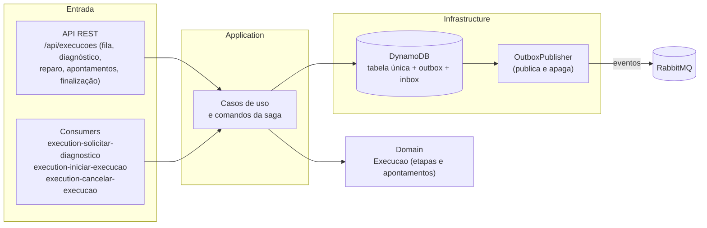
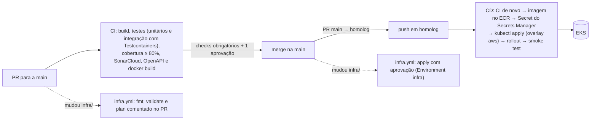

# oficina-execution-service

[](https://sonarcloud.io/summary/new_code?id=Duds27_oficina-execution-service) [](https://sonarcloud.io/summary/new_code?id=Duds27_oficina-execution-service)

Microsserviço de **diagnóstico e execução** da Oficina Mecânica (FIAP 15SOAT, Fase 4).

> **Estado atual (Fase 4):** implementado e validado fora da AWS. Etapas 1 a 5 concluídas; a implantação no EKS, o New Relic com dados e o sandbox do Mercado Pago estão na [Etapa 6](https://github.com/Duds27/oficina-os-service/blob/main/docs/fase4/etapa-6-documentacao-entrega.md#60-implantação-na-aws-e-validação-no-new-relic).

## Responsabilidades

- Manter a fila de trabalho da oficina, criada a partir dos comandos `SolicitarDiagnostico` e `IniciarExecucao`.
- Registrar o diagnóstico e o reparo (apontamentos e linha do tempo).
- Avisar o `os-service` de cada avanço: diagnóstico iniciado e concluído, execução iniciada, rejeitada e finalizada.
- Cancelar a execução quando a saga mandar (`CancelarExecucao`).

**Não é dele:**

- Orçamento e pagamento: são do `billing-service`.
- Cadastro e ciclo de vida da OS: são do `os-service`.

Os dados de que precisa chegam dentro das mensagens. Ver os [contratos de mensagens](https://github.com/Duds27/oficina-os-service/blob/main/docs/contratos-mensagens.md).

## Arquitetura do serviço



Clean Architecture. A gravação de uma operação (execução, apontamentos, outbox e inbox) é uma transação
condicional do DynamoDB. O `OutboxPublisher` publica depois, continuando o trace de quem gravou.

## Etapas da execução

```
DiagnosticoPendente → EmDiagnostico → DiagnosticoConcluido → AguardandoExecucao → EmReparo → Finalizada
                 (qualquer etapa não final) → Cancelada
```

| Quem | O quê | Etapa | Evento para a saga |
| --- | --- | --- | --- |
| Saga | `SolicitarDiagnostico` | → `DiagnosticoPendente` | — |
| Mecânico | `POST …/diagnostico/iniciar` | → `EmDiagnostico` | `DiagnosticoIniciado` |
| Mecânico | `POST …/diagnostico/concluir` | → `DiagnosticoConcluido` | `DiagnosticoConcluido` |
| Saga | `IniciarExecucao` (pagamento confirmado) | → `AguardandoExecucao` | `ExecucaoIniciada` ou `ExecucaoRejeitada` |
| Mecânico | `POST …/reparo/iniciar` | → `EmReparo` | — |
| Mecânico | `POST …/finalizar` | → `Finalizada` | `ExecucaoFinalizada` (com a duração) |
| Saga | `CancelarExecucao` (compensação) | → `Cancelada` | — |

Regras que valem saber:

- `IniciarExecucao` só é aceito com o diagnóstico concluído. Fora disso, a resposta é `ExecucaoRejeitada` com o motivo.
- Uma rejeição com o diagnóstico concluído (na prática, a falha simulada) também encerra a execução como `Cancelada`. A saga compensa sem mandar `CancelarExecucao`, e a execução ficaria presa na fila.
- `CancelarExecucao` em etapa final é ignorado. Se chegar antes do `SolicitarDiagnostico`, registra a execução já cancelada, e o pedido atrasado é ignorado (regra 5 da seção 5 dos contratos).

## Mensagens

| Direção | Mensagem | Fila / exchange | Quando |
| --- | --- | --- | --- |
| Consome | `SolicitarDiagnostico` | `execution-solicitar-diagnostico` | OS aberta: a execução entra na fila |
| Consome | `IniciarExecucao` | `execution-iniciar-execucao` | Pagamento confirmado: libera o reparo com os serviços aprovados |
| Consome | `CancelarExecucao` | `execution-cancelar-execucao` | C1, C2 ou C3: encerra a execução |
| Publica | `DiagnosticoIniciado` / `DiagnosticoConcluido` | `oficina.diagnostico-iniciado.v1` / `oficina.diagnostico-concluido.v1` | Mecânico inicia e conclui o diagnóstico |
| Publica | `ExecucaoIniciada` / `ExecucaoRejeitada` | `oficina.execucao-iniciada.v1` / `oficina.execucao-rejeitada.v1` | Resposta ao `IniciarExecucao` (a rejeição dispara a C3) |
| Publica | `ExecucaoFinalizada` | `oficina.execucao-finalizada.v1` | Reparo finalizado, com a duração |

Contratos completos: [`contratos-mensagens.md`](https://github.com/Duds27/oficina-os-service/blob/main/docs/contratos-mensagens.md).

## API

Swagger em `/swagger` no ambiente de desenvolvimento. O contrato completo está versionado em [`docs/openapi.json`](docs/openapi.json), conferido no CI.

Todas as rotas exigem JWT com papel `Admin` ou `Mecanico`. O token de cliente (login por CPF na Lambda) recebe 403. O mecânico e o autor dos apontamentos vêm do usuário do token.

| Método | Rota | Descrição |
| --- | --- | --- |
| GET | `/api/execucoes/fila?etapa=&limite=` | Fila de uma etapa, por ordem de chegada nela (padrão: `DiagnosticoPendente`, 50 itens) |
| GET | `/api/execucoes/{osId}` | Execução + linha do tempo de apontamentos |
| POST | `/api/execucoes/{osId}/diagnostico/iniciar` | Inicia o diagnóstico |
| POST | `/api/execucoes/{osId}/diagnostico/concluir` | Conclui o diagnóstico. Corpo: `{ "observacoes": "..." }` (opcional) |
| POST | `/api/execucoes/{osId}/reparo/iniciar` | Marca o início do reparo |
| POST | `/api/execucoes/{osId}/apontamentos` | Observação livre. Corpo: `{ "texto": "..." }` |
| POST | `/api/execucoes/{osId}/finalizar` | Finaliza o reparo |

Erros: `404` sem execução para a OS · `409` operação fora da etapa (com o motivo) · `400` parâmetro ou corpo inválido.

## Persistência e mensageria

- **DynamoDB, uma tabela só:**

  | Item | PK | SK | Para quê |
  | --- | --- | --- | --- |
  | Execução | `EXEC#{osId}` | `META` | Agregado, com `Version` e a fila no GSI1 (`FILA#{etapa}` / `{entrada na etapa}#{osId}`) |
  | Apontamento | `EXEC#{osId}` | `EVT#{data}#{id}` | Linha do tempo |
  | Mensagem processada | `MSG#{messageId}` | `MSG` | Deduplicação, com TTL de 7 dias em `ExpiraEm` |
  | Outbox | `OUTBOX#{id}` | `OUTBOX` | Eventos a publicar, em ordem pelo GSI2 |

- **Uma transação por mudança** (`TransactWriteItems`): o `MSG#` com `attribute_not_exists`, o `META` com condição na `Version`, os apontamentos novos e o outbox. Mensagem repetida não grava nada; conflito de versão é reprocessado.
- **Outbox:** o `OutboxPublisher` lê o GSI2 a cada 2 s, publica no RabbitMQ com `MessageId` = id do item e apaga. Se cair entre publicar e apagar, publica de novo com o mesmo `MessageId`, e o inbox do os-service descarta a repetida.
- **MassTransit 8.4.1 + RabbitMQ**, no padrão do os-service: filas de comando com nome fixo (`execution-solicitar-diagnostico`, `execution-iniciar-execucao`, `execution-cancelar-execucao`), retry exponencial (5 tentativas, 200 ms a 30 s) e `<fila>_error` quando esgota. O redelivery atrasado fica para a Etapa 4.
- **Logs:** todo consumo leva `CorrelationId`, `NumeroOS`, `OsId`, `TipoMensagem` e `MessageId`.

## Saga: estratégia e justificativa

A OS atravessa os 3 serviços numa saga **orquestrada**:

- **o os-service guarda o estado:** é a máquina de estados do MassTransit, gravada no MySQL;
- **o os-service manda os comandos:** um para cada passo;
- **os outros dois só respondem:** o billing e o execution executam o comando e publicam eventos, sem conhecer a saga.

**Por quê** ([ADR-006](https://github.com/Duds27/oficina-os-service/blob/main/docs/architecture/adrs/ADR-006-saga-orquestrada.md)):

- o fluxo e as compensações ficam num lugar só;
- dá para responder "em que passo esta OS parou?" (`GET /api/ordens-servico/{id}/saga`);
- o fluxo inteiro pode ser testado de ponta a ponta.

Com coreografia, a lógica de compensação ficaria espalhada por três repositórios.

**Papel deste serviço:** participante. Recebe `SolicitarDiagnostico`, `IniciarExecucao` e `CancelarExecucao` e publica o andamento. `ExecucaoRejeitada` (ou a flag de *fault injection*) dispara a compensação C3, com estorno.

**Compensações:**

- C1: orçamento recusado;
- C2: pagamento recusado ou prazo vencido;
- C3: execução rejeitada, com estorno.

Os diagramas de cada uma estão nos [diagramas de sequência](https://github.com/Duds27/oficina-os-service/blob/main/docs/architecture/sequence-diagrams.md). O
catálogo das mensagens, com as regras de eventos fora de ordem, está nos [contratos](https://github.com/Duds27/oficina-os-service/blob/main/docs/contratos-mensagens.md).

## Configuração

| Variável | Uso |
| --- | --- |
| `Jwt__Key`, `Jwt__Issuer`, `Jwt__Audience` | Mesmo JWT do os-service e da Lambda |
| `DynamoDb__TableName` | Tabela (padrão `oficina-execucoes`; na AWS, o output do Terraform) |
| `DynamoDb__ServiceUrl` | Só para o DynamoDB Local. Vazio na AWS: região e credenciais vêm do ambiente (IRSA) |
| `RabbitMq__Host`, `__Port`, `__VirtualHost`, `__Username`, `__Password` | Broker |
| `FaultInjection__RejeitarExecucao` | `true` faz todo `IniciarExecucao` ser rejeitado com "falha simulada" (demo da compensação C3). O valor é logado na inicialização |
| `Outbox__IntervaloMs`, `Outbox__Lote` | Leitura do outbox (padrão 2000 ms, 25 itens) |

No ambiente `Development`, o serviço cria a tabela no DynamoDB Local ao subir. Fora dele, a tabela tem que existir (Terraform).

## Estrutura

```
src/
  Oficina.Execution.Domain/          agregado Execucao, etapas e apontamentos
  Oficina.Execution.Application/     casos de uso, contratos (Oficina.Contracts) e portas
  Oficina.Execution.Infrastructure/  DynamoDB (single-table + outbox próprio), MassTransit
  Oficina.Execution.API/             controllers, autorização, health checks
infra/                               Terraform: tabela, role IRSA e ECR
tests/
  Oficina.Execution.UnitTests/         domínio, casos de uso, consumers (test harness), outbox, contratos
  Oficina.Execution.IntegrationTests/  DynamoDB Local e RabbitMQ (Testcontainers), API
```

- **Versões:** os pacotes ficam centralizados em `Directory.Packages.props`. O MassTransit fica na 8.x (a 9 é comercial).
- **Avisos:** no código de `src/`, todo aviso é tratado como erro (`src/Directory.Build.props`).
- **SDK:** o `global.json` fixa o .NET 8.

## Como rodar

Testes (os de integração sobem DynamoDB Local e RabbitMQ no Docker):

```bash
dotnet test
```

Serviço + DynamoDB Local + RabbitMQ próprio:

```bash
docker compose up --build
```

- Health checks: http://localhost:8083/health/live e http://localhost:8083/health/ready
- Swagger: http://localhost:8083/swagger
- RabbitMQ: http://localhost:15672 (usuário `oficina`, senha `oficina_dev`)

Junto com o os-service, no RabbitMQ dele (suba o compose do os-service antes):

```bash
docker compose -f docker-compose.yml -f docker-compose.integrado.yml up --build execution-api dynamodb
```

Abrir uma OS no os-service gera o `SolicitarDiagnostico`, e a execução aparece na fila. Iniciar e concluir o diagnóstico aqui levam a saga do os-service a `EmDiagnostico` e depois a `AguardandoOrcamento`.

Sem Docker: `dotnet run --project src/Oficina.Execution.API` (porta 8083; precisa do DynamoDB Local em `localhost:8000` e do RabbitMQ).

## Infra (Terraform)

`infra/` cria a tabela DynamoDB (on-demand, GSI1 e GSI2, TTL, point-in-time recovery), a role IRSA do pod e o ECR. O estado fica no bucket S3 da Fase 3 (`execution-service/<ambiente>/terraform.tfstate`), e o OIDC provider vem do estado do `oficina-infra-k8s`.

```bash
cd infra
terraform init -backend-config="bucket=$TF_STATE_BUCKET" -backend-config="key=execution-service/$ENV/terraform.tfstate" \
  -backend-config="region=$AWS_REGION" -backend-config="dynamodb_table=$TF_LOCK_TABLE"
terraform apply -var="environment=$ENV" -var="state_bucket=$TF_STATE_BUCKET"
```

- A role só pode ser assumida pela ServiceAccount `execution-service` do namespace `oficina-execution`.
- A política dá só `GetItem`, `Query`, `PutItem`, `UpdateItem`, `DeleteItem` e `ConditionCheckItem` na tabela e nos índices. Não existe ação IAM `TransactWriteItems`: a transação é autorizada item a item.
- `terraform test` roda sem conta AWS (provider mockado).

## CD

O `.github/workflows/cd.yml` faz o deploy no EKS a cada push em `homolog` ou `prod`. Antes, chama o
CI (`workflow_call`), e o deploy só roda se testes, cobertura e quality gate passarem no mesmo
commit. O job usa o Environment com o nome da branch. Em `prod`, a aprovação fica nas
regras do Environment.

1. Confere as variables do Environment e para com a lista do que falta.
2. Builda e publica a imagem no ECR com a tag do commit.
3. Monta o Secret `execution-service-secrets` a partir do Secrets Manager, com os valores mascarados no log. Sem credencial da AWS: a tabela é acessada pela role IRSA da ServiceAccount.
4. Troca a imagem e os placeholders do overlay `aws`. Placeholder sem valor derruba o deploy antes do `apply`.
5. `kubectl apply`, anota o pod com o hash do Secret (credencial trocada sem mudança de código também
   reinicia os pods) e espera o rollout (300 s).
6. Smoke test: um pod com `curl` chama `http://execution-service/health/ready` dentro do namespace `oficina-execution`.

| Tipo (Environment `homolog`/`prod`) | Nome | De onde vem |
| --- | --- | --- |
| Variable | `AWS_REGION` | `us-east-1` |
| Variable | `ECR_REPOSITORY` | saída `ecr_repository_url` do `infra/` (só o nome do repositório) |
| Variable | `EKS_CLUSTER_NAME` | saída `cluster_name` do `oficina-infra-k8s` |
| Variable | `TARGET_GROUP_ARN` | saída `target_group_arns["execution"]` do `oficina-infra-k8s` |
| Variable | `RABBITMQ_SECRET_ID` | saída `rabbitmq_secret_ids["execution"]` do `oficina-infra-k8s` |
| Variable | `JWT_SECRET_ID` | secret `{"key"}` da chave do JWT, o mesmo da Lambda |
| Variable | `DYNAMODB_TABLE` | saída `dynamodb_table_name` do `infra/` |
| Variable | `IRSA_ROLE_ARN` | saída `irsa_role_arn` do `infra/` |
| Secret | `AWS_DEPLOY_ROLE_ARN` | role do GitHub OIDC (a mesma da Fase 3) |
| Secret | `SONAR_TOKEN` | SonarCloud (já cadastrado na Etapa 0) |
| Secret | `NEW_RELIC_LICENSE_KEY` | opcional; com ela, o CD liga o OpenTelemetry → New Relic (OTLP) |
| Variable | `NEW_RELIC_OTLP_ENDPOINT` | opcional; padrão `https://otlp.nr-data.net:4317` (conta na UE: `https://otlp.eu01.nr-data.net:4317`) |

### Infra (`infra.yml`)

Para mudanças em `infra/`:

- **PR na `main`:** `fmt`, `validate` e `plan` de homolog, com o plano num comentário do PR,
  atualizado a cada push.
- **Push na `main`:** `apply` em homolog, depois da aprovação no Environment `infra`
  (*required reviewers*).
- **Manual:** `plan` ou `apply` no ambiente escolhido. O `apply` também passa pelo Environment `infra`.

Usa as variables `AWS_REGION`, `TF_STATE_BUCKET` e `TF_LOCK_TABLE` e o secret `AWS_DEPLOY_ROLE_ARN`
**do repositório**, não de um Environment. O estado do `infra-k8s` do mesmo ambiente precisa existir.

## Observabilidade

O OpenTelemetry .NET (`src/Oficina.Execution.API/Observabilidade/Telemetria.cs`) exporta traces, métricas e logs por
OTLP quando `OTEL_EXPORTER_OTLP_ENDPOINT` existe. Sem ele, nada sai, e é assim nos testes e no compose
sem coletor. No EKS, o CD liga o envio para o New Relic quando há license key.

- **Traces:** ASP.NET Core (fora `/health` e `/swagger`), HttpClient, MassTransit (publish, send e
  consume, com o contexto propagado nos headers da mensagem) e DynamoDB (instrumentação do AWS SDK). O outbox do DynamoDB grava o `traceparent` junto
  com a mensagem, e a publicação (span `outbox publish <Evento>`) continua o trace que a gravou.
- **Métricas:** HTTP, runtime do .NET, MassTransit e as de negócio do Meter `Oficina.Execucao`:
  - `execucao.duracao` (s): do início do reparo à finalização;
  - `execucao.fila.tamanho{etapa}`: OS em cada etapa da fila, contadas a cada 30 s (`Metricas__IntervaloFila`). Cada réplica conta a fila inteira; no New Relic, use `latest()` ou `max()`.
- **Logs:** o Serilog manda os logs por OTLP, ligados ao trace. Todo log tem `trace.id` e `span.id`, e
  os do consumo de mensagens têm `MessageType`, `CorrelationId` e `NumeroOS` (filtro do MassTransit).
  Filtrar por `NumeroOS` no New Relic mostra a OS nos 3 serviços.
- **Resource:** `service.name` = `execution-service`, `service.version` = SHA do commit (`SERVICE_VERSION`, passado
  pelo CD no build) e `deployment.environment` (`Observabilidade__Ambiente`).

Para conferir local, use o perfil `observabilidade` do `docker-compose.full.yml` do os-service, que sobe
um OpenTelemetry Collector com Jaeger. O `scripts/e2e_observabilidade.py` de lá confere trace, métricas e
logs.

## Kubernetes

Os manifestos ficam em [`k8s/`](k8s/README.md): a base, o overlay `local` para o kind e o `aws`
para o EKS. O serviço roda no namespace `oficina-execution` e usa o RabbitMQ em
`rabbitmq.messaging.svc.cluster.local`. No kind, o overlay local do `oficina-os-service` sobe
esse broker (aplique aquele primeiro), e o DynamoDB Local roda no próprio overlay.

## CI

O `.github/workflows/ci.yml` roda em PR e push na `main`, e o CD o reutiliza (`workflow_call`):

- `build-test-quality` (*required check* da proteção da `main`): restore, build, testes com cobertura (`coverlet.runsettings`, só os assemblies `Oficina.Execution.*`), SonarCloud, gate de cobertura e build da imagem Docker.
- **Gate de cobertura:** o ReportGenerator junta a cobertura de todos os projetos de teste, e o passo falha se a de linhas ficar abaixo de 80%. O resumo vai para a página do run, e o relatório fica no artifact `coverage`.
- **SonarCloud:** análise com `dotnet-sonarscanner`, cobertura em opencover e `sonar.qualitygate.wait=true`. Quality gate reprovado derruba o job. Em PR de fork ou do Dependabot, sem o `SONAR_TOKEN`, os passos do Sonar são pulados.
- `terraform`: `fmt`, `validate` e `test` do `infra/`.

Cobertura de linhas em 2026-11-16: 97,4%, com 130 testes.

### Pipeline



## Evidências de cobertura

 

O relatório do CI da `main`, consolidado pelo ReportGenerator, está em [`docs/evidencias`](docs/evidencias/README.md),
com o run e o commit de origem. O SonarCloud está em [Duds27_oficina-execution-service](https://sonarcloud.io/summary/new_code?id=Duds27_oficina-execution-service).
O gate do CI derruba o build abaixo de 80% de linhas.
